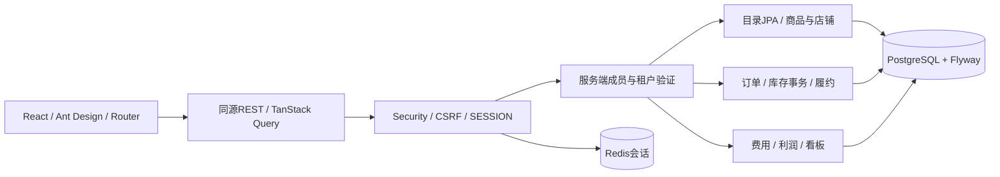

# 架构与数据模型

单仓库、单API进程、同一PostgreSQL事务边界；阶段二增加事务Outbox、RabbitMQ、平台适配器和授权文件存储；真实Shopify/S3联调仍待凭据。商品目录已建立Spring Modulith catalog边界并使用Spring Data JPA租户限定查询；订单/库存/财务写入使用JdbcTemplate显式SQL，后续仍需进一步拆分根包控制器依赖。

## 主要实体

| 表 | 约束与用途 |
|---|---|
| tenant / app_user / membership | 成员按username+tenant唯一，角色实时验证 |
| product / sku | 企业复合外键，SKU企业内唯一，NUMERIC成本 |
| store / store_listing | 明确MOCK连接，平台商品标识店铺内唯一，关联SKU同企业 |
| warehouse / inventory | 企业+SKU+仓库唯一，reserved非负且不超过on_hand |
| inventory_reservation | 企业/订单/SKU唯一，RESERVED/RELEASED/CONSUMED |
| stock_receipt | 企业+request_key唯一，记录仓库与数量，防重入库 |
| sales_order / order_item | 企业+店铺+平台号唯一；固定履约仓库，独立支付/退款状态 |
| inventory_movement | 订单/SKU/事件类型唯一，保存仓库、数量及UTC时间 |
| shipment | 企业/订单唯一，整单手工运单 |
| order_fee | 原币、币种、汇率、来源、生效时间及折算CNY，类别唯一 |
| audit_log | 企业、操作人、动作、对象、UTC；与业务同事务 |

订单汇率快照和采购成本快照当前内嵌order/order_item；费用快照内嵌order_fee。尚无独立ExchangeRateSnapshot表；SyncJob/OutboxEvent/ProcessedEvent等在阶段二实现，不能将本模型视为最终全量模型。

## 库存一致性

订单行锁串行化同订单状态操作。多SKU按SKU排序更新，条件更新同时检查指定仓可用量；任何一项失败整体回滚。预占实体与流水同事务。发货减少现存和预占并保存运单；取消预占释放，NEW取消不改库存。入库数量上限采用条件更新，入库键跨仓/数量不一致返回冲突。

独立Testcontainers测试执行全部迁移，并验证200单/20工作线程竞争100库存、整单回滚、重复操作、取消及跨仓不借货。

## 安全与时间

Cookie会话由Redis保存。POST要求CSRF；所有资源查询及关联写入验证企业范围，缓存键含用户和企业，服务端API响应no-store。文件/搜索/向量未启用，不能据此声称这些边界已验收。日志使用随机请求关联标识，不记录请求正文。

数据库时间UTC，界面按浏览器时区显示；趋势按UTC日期分组并明确说明。金额计算仅BigDecimal/NUMERIC，接口十进制字符串，图表只将已计算金额转换为绘图坐标。

入库待重试请求保存在按用户/企业分隔的sessionStorage，仅包含请求键、内部SKU/仓库和数量，成功后删除；不保存客户数据或接口响应。无Service Worker/PWA缓存，PWA将在阶段三实现。

## 当前边界

单商品单SKU创建界面、CSV每单一行、整单单仓履约、全部利润为预估。图片/对象存储、真实平台、物流事件、完整结算、PWA和消息可靠性未实现。原币费用按类别可编辑且审计，尚未提供不可变结算版本。

## 阶段二边界

业务事务同时写audit_log/outbox_event → 调度器锁定待投递行 → Broker确认后SENT → 消费事务中processed_event唯一键与同步变更、sync_job共同提交。失败回滚后独立记录FAILED，三次消费失败进入持久死信。人工重放仍复用原事件ID，已完成不能重放。Webhook inbox与Outbox同事务，后台重取权威状态；新订单固化采购与汇率，旧事件不能改写。

V11消息、V12文件元数据、V13平台连接/收件箱、V14同步仓库/汇率、V15外部履约。存储对象以企业/文件UUID为key，数据库复合外键限定商品图片所属企业；本地文件卷持久化，S3通过相同BlobStore契约。Nginx使用Docker DNS动态刷新API地址。详细测试证据、外部凭据和限制见PHASE_TWO_REPORT.md。

## 第三阶段增强边界

ProductSearch每企业独立OpenSearch索引，返回SKU ID后主库再次限定tenant；索引不可用返回数据库基础查询。知识文档/块及草稿位于主库V16迁移，向量库为可选派生索引，向量查询显式tenant条件、维度条件并在主库重新授权。AiModels封装Spring AI ChatModel/EmbeddingModel，明确DISABLED/FIXED_DEMO/MODEL三状态。独立事务预扣每日UTC模型额度，失败不返还。真实模型仅显式AI_ENABLED才创建，配置不进入日志。

Actuator9090仅内部指标，Prometheus抓取、Grafana面板、OTLP Collector独立profile；追踪默认关闭，开启时通过Micrometer OTel桥导出。PWA仅缓存静态资源；离线不缓存客户/订单/库存，不自动补交写入。具体实测与尚未验证条件见PHASE_THREE_REPORT.md。
